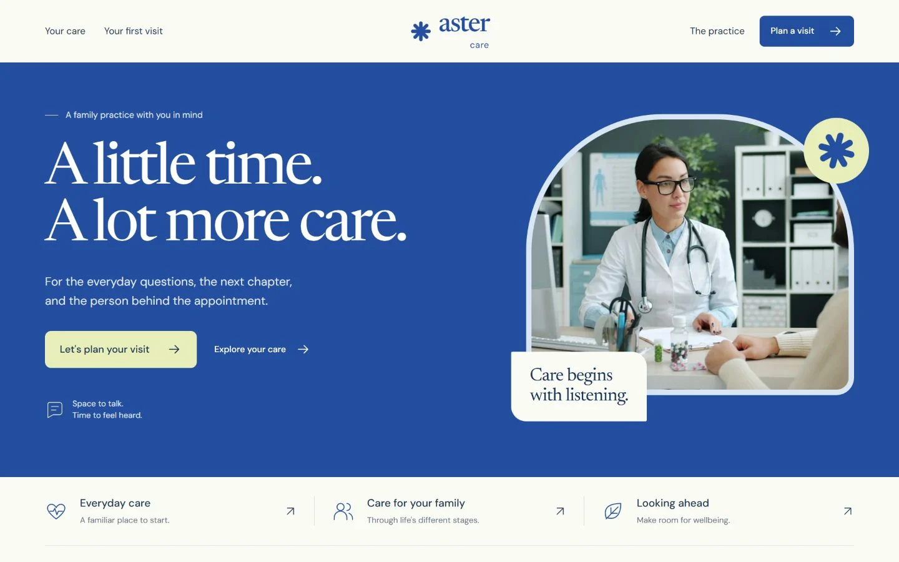

# Customize a clinic website without a framework build

A small practice website should make practical information easy to find: services, hours, location and how to get in touch. This guide uses [Aster Care](../README.md), a free HTML/CSS/JavaScript template, to show how to adapt those sections without confusing a public website with a patient application.

[View Aster Care](https://store.usmankhairdin.com/aster-care/?utm_source=github&utm_medium=referral&utm_campaign=practical_guides&utm_content=clinic_demo)



## Map the page to the practice

Open `index.html`. The existing section IDs include `care`, `our-way`, `first-visit`, `practice`, `faq` and `request`. Navigation uses these anchors. Replace the visible headings and copy while retaining IDs unless you also update their incoming links.

Start with the practice name, title, description, contact details and opening hours. Search the full HTML file for the fictional name and example destinations; header, footer and form-related text can contain separate instances. Do not leave demonstration claims or services that the practice does not provide.

## Explain services in the care section

Use familiar service names and a short description of what each covers. The care content has its own headings and accordion structure. Change its text inside the existing elements so that the disclosure controls keep their working relationships.

The template also contains a first-visit section. Replace general sample instructions with the practice's actual process. If appointments need confirmation by a receptionist, say that plainly. A message draft and a confirmed appointment are different outcomes.

## Adjust the visual identity

The main stylesheet is `assets/css/aster.css`; interactions live in `assets/js/aster.js`. Begin with the existing colour definitions rather than scattering new overrides across individual elements.

After changing colours, inspect paragraph text, muted labels, button text, links and field borders against their real backgrounds. Check open menus and dialogs too. Preserve visible keyboard focus and keep text readable when a field has an error.

Replace photography with appropriately licensed images. Update alternative text when the subject changes, keep filenames and relative paths consistent, and inspect crops on a phone-sized viewport.

## Understand the request flow before connecting anything

The page includes a dialog named `request-dialog` and a form named `request-form`. The supplied interaction prepares an unsent local draft. It does not create a patient record, make a booking or notify staff.

Try it with invented contact details so you understand the visible result. Do not use real patient information in this demo. If you need a real appointment service, implement that separately with suitable storage, access controls and a clear response to the visitor. Never place a private service key in HTML or JavaScript.

## Publish the public website

Keep `index.html`, `assets/`, licences and notices together. You can preview locally with an HTTP server:

```sh
python -m http.server 4210 --bind 127.0.0.1
```

Open `http://127.0.0.1:4210/`. Check header links, every accordion, request-dialog open/close, required fields, keyboard focus and the final draft. Test at desktop and phone widths. Upload the same folder structure to your static host; there is no application build command.

## When the brief includes an application

A public practice landing page and a coverage dashboard solve different jobs. If you are evaluating a healthcare application interface, [Avenlo Coverage Workspace](https://store.usmankhairdin.com/templates/avenlo-dashboard/?utm_source=github&utm_medium=referral&utm_campaign=practical_guides&utm_content=healthcare_dashboard) is a separate paid frontend template from UKD Store. Its demo does not provide real insurance, patient care or production authentication. Use the preview to assess the interface and read the included scope before buying.

Written by the creator of Aster Care and UKD Store, Usman Khair Din.
